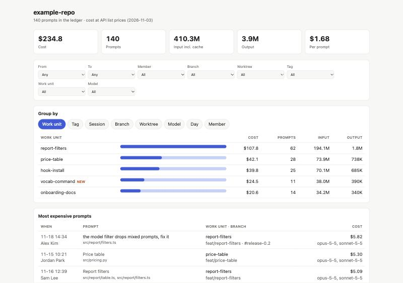

<h1 align="center">token-ledger</h1>

<p align="center">
  <em>팀의 Claude Code 토큰은 어디에 쓰였을까? 프롬프트별, 기능별, 브랜치별로 확인하세요.</em>
</p>

<p align="center">
  
  
  
  <a href="LICENSE"></a>
</p>

<p align="center">
  <a href="README.md">English</a> · <b>한국어</b>
</p>

<p align="center">
  <picture>
    <source media="(prefers-color-scheme: dark)" srcset="examples/screenshot-dark.jpg">
    
  </picture>
</p>

token-ledger는 git 레포에서 쓰인 모든 Claude Code 프롬프트의 토큰 사용량을 팀원 모두에 대해 기록합니다. 기록은 git으로 공유되므로 모든 팀원이 같은 숫자를 봅니다. 그다음 프롬프트를 `report-filters`, `pricing-fix` 같은 작업 단위로 묶고, 필터와 그룹 기준을 바꿔 볼 수 있는 HTML 리포트를 만듭니다.

- **새 습관이 필요 없습니다.** 기록은 pre-commit hook이 추가합니다. 평소처럼 작업하고 커밋하면 됩니다.
- **git에 프롬프트 내용이 없습니다.** 커밋되는 기록에는 숫자, 브랜치, 태그, 세션 제목, 바뀐 파일 경로가 들어갑니다. [개인정보](#개인정보)를 참고하세요.
- **기능 단위로 묶입니다.** 같은 파일을 고친 프롬프트는 같은 작업 단위가 됩니다. 각 단위의 한 줄 이름은 Claude Haiku가 짓고, 모델을 끄면 파일 이름에서 가져옵니다.
- **이름을 공유합니다.** 단어장 파일 덕분에 단위 이름이 팀 전체에서, 실행할 때마다 같게 유지됩니다.
- **직접 붙이는 라벨도 있습니다.** 태그로 릴리스나 실험을 표시할 수 있고, 자동 묶음과는 따로 동작합니다.

## 빠른 시작

**1. Claude Code에서 플러그인을 설치합니다:**

```
/plugin marketplace add kwakyongwoo/token-ledger
/plugin install token-ledger@token-ledger
```

**2. CLI를 설치합니다** ([`uv`](https://docs.astral.sh/uv/) 필요). 이 단계를 건너뛰면, token-ledger를 쓰는 레포를 처음 열 때 Claude가 대신 설치해 주겠다고 제안합니다.

```bash
uv tool install git+https://github.com/kwakyongwoo/token-ledger
```

**3. 레포에서 켭니다** (한 사람이 한 번만). 그다음 새로 생긴 파일을 커밋합니다:

```
/token-ledger:init
```

**4. 평소처럼 작업하고 커밋합니다.** 나중에 리포트를 엽니다:

```
/token-ledger:report
```

팀원은 1단계와 2단계만 하면 됩니다. 레포를 열면 SessionStart hook이 pre-commit hook을 대신 설치합니다.

## 예시 보기

[`examples/report.html`](examples/report.html)은 가상 데이터(팀원 3명, 프롬프트 140개)로 만든 전체 리포트입니다. 브라우저에서 열어 필터와 그룹 기준 버튼을 눌러 보세요. [`examples/token-ledger-out/`](examples/token-ledger-out/)에서 실제로 커밋되는 내용을 볼 수 있습니다. 다시 만들려면 `python3 examples/make_example.py`를 실행하세요.

## 리포트에서 볼 수 있는 것

| | |
|---|---|
| **요약 카드** | 비용, 프롬프트 수, 입력, 출력, 프롬프트당 비용 |
| **필터** | 기간, 팀원, 브랜치, 워크트리, 태그, 작업 단위, 모델 |
| **그룹 기준** | 작업 단위, 태그, 세션, 브랜치, 워크트리, 모델, 날짜, 팀원 |
| **비용이 큰 프롬프트** | 상위 25개. 짧은 발췌는 내 프롬프트에만 표시 |
| **라이트·다크** | 시스템 테마를 따름 |

커밋되는 기록 한 줄에는 다음이 들어갑니다:
- 모델별 토큰: 입력, 출력, 캐시 쓰기, 캐시 읽기, thinking
- API 정가 기준 비용
- 작업 시간 (사용자를 기다리는 시간처럼 5분 넘는 공백은 빼고 계산)
- Claude Code 버전
- 도구 호출과 서브에이전트 수
- 브랜치, 워크트리, 태그
- 세션 제목과 수정한 파일의 레포 기준 경로

## 동작 방식

```
Claude Code 세션 ──> ~/.claude/projects/*.jsonl   (로컬 대화 기록)
                                        │
git commit ──> pre-commit hook ──> token-ledger collect
                                        │  끝난 프롬프트만, 프롬프트 내용 제외
                                        ▼
                    token-ledger-out/data/<member>/<time>-<id>.jsonl   (커밋됨, 한 번 쓰고 수정 안 함)
                                        │
token-ledger report ──> 작업 단위로 묶기 ──> 새 단위 이름 짓기(Haiku) ──> report.html
```

1. **수집.** 커밋할 때마다 hook이 로컬 대화 기록에서 아직 읽지 않은 부분만 읽습니다. 이 레포를 건드렸고 끝난 프롬프트만 남깁니다. 다음 프롬프트가 있거나, 정상 응답 뒤 세션이 30분 동안 조용하면 끝난 것으로 봅니다.
2. **공유.** 실행할 때마다 새 파일을 쓰고, 그 파일은 다시 수정하지 않습니다. 두 사람이 동시에 커밋해도 충돌이 나지 않습니다.
3. **묶기.** 다음 경우에 프롬프트끼리 연결됩니다:
   - 같은 파일을 고친 경우 (가장 강하게)
   - 한 세션에서 연달아 나온 경우
   - 같은 기능 브랜치인 경우

   그다음 Louvain 커뮤니티 탐지로 묶음을 찾습니다.
4. **이름 짓기.** `claude -p --model haiku` 한 번으로 새 묶음 전부에 이름을 붙입니다. 프롬프트 내용이 아니라 파일 경로, 브랜치, 세션 제목을 보냅니다. 이미 이름이 있는 묶음은 그 이름을 그대로 씁니다.

## 비용과 속도

대화 기록이 192 MB인 실제 레포에서 측정했습니다:

| 언제 | 추가 시간 | 토큰 |
|---|---|---|
| 커밋할 때마다 | 약 0.2초 (처음 한 번은 1.5초) | 0 |
| Claude Code를 열 때 | 약 0.2초 | 0 |
| `token-ledger report` | 이름 짓기 포함 약 8초 | 새 묶음이 있을 때만 작은 Haiku 호출 한 번 |

모델을 아예 쓰지 않으려면 `"classify": false`로 설정하세요.

## 명령어

| Claude Code에서 | CLI | 하는 일 |
|---|---|---|
| `/token-ledger:init` | `token-ledger init` | 이 레포에서 token-ledger를 켭니다 |
| `/token-ledger:report` | `token-ledger report` | 새 프롬프트를 묶은 뒤 `token-ledger-out/report.html`을 만듭니다 |
| `/token-ledger:tag <name>` | `token-ledger tag <name>` | 현재 브랜치의 이후 프롬프트에 태그를 붙입니다 (`off`로 끔). 세션을 시작할 때 켜진 태그를 알려줍니다 |
| `/token-ledger:vocab` | `token-ledger vocab list\|merge\|rename\|ok` | 작업 단위 이름을 합치고, 바꾸고, 확인 처리합니다 |
| | `token-ledger summary --by branch` | 터미널에서 간단히 합계를 봅니다 |
| | `token-ledger doctor` | 설정, 빠진 기록, 대화 기록 형식 변경을 점검합니다 |
| | `token-ledger collect --rebuild` | 기록이 사라진 프롬프트를 다시 추가합니다 (예: `git reset --hard` 이후) |
| | `token-ledger hook status\|install\|uninstall` | 내 pre-commit hook만 관리합니다 |

## 설정

`token-ledger-out/config.json`:

| 키 | 기본값 | 의미 |
|---|---|---|
| `classify` | `true` | 새 작업 단위 이름을 Claude Haiku로 짓습니다. `false`면 파일 이름, 브랜치, 세션 제목 순으로 가져옵니다. |

## 개인정보

- **커밋되지 않는 것:** 프롬프트 내용과 답변. 짧은 발췌는 내 컴퓨터의 `.git/token-ledger/`에만 남습니다.
- **커밋되는 것:** 숫자, 브랜치, 태그, 세션 제목, 레포 기준 경로, 각 팀원의 `git config user.name`. Claude Code는 첫 프롬프트를 보고 세션 제목을 짓기 때문에, 세션 제목에서 질문 내용을 짐작할 수 있습니다.
- **예외 하나:** 파일을 바꾸지 않았고 내 프롬프트로만 이루어진 작업 단위는 그 프롬프트의 짧은 발췌로 이름을 짓습니다. 그래서 이름에 질문 내용이 드러날 수 있습니다.
- **팀에 알리기:** 켜기 전에 팀에 알리세요. 각자 `token-ledger hook uninstall`로 자기 컴퓨터에서 끌 수 있습니다.

## 자주 묻는 질문

**커밋했는데 마지막 프롬프트가 없어요.**
아직 실행 중이었거나 세션이 30분 동안 조용하지 않았기 때문입니다. 다음 커밋 때 들어갑니다.

**리포트를 갱신하려면 커밋해야 하나요?**
아니요. `token-ledger report`는 `token-ledger-out/data/`의 모든 기록을 읽습니다. pull을 받으면 팀원 기록도 포함됩니다. 내 최신 프롬프트를 바로 넣으려면 먼저 `token-ledger collect`를 실행하세요.

**비용이 실제로 내는 금액인가요?**
API 정가(2026-11-03 확인) 기준 추정치입니다. 구독 요금제라면 같은 사용량을 API로 썼을 때의 금액입니다. 가격을 모르는 모델은 비용을 표시하지 않습니다.

**워크트리와 서브에이전트도 되나요?**
네. 같은 레포의 워크트리는 합쳐서 보여주고, 서브에이전트 토큰은 그 서브에이전트를 시작한 프롬프트에 더해집니다.

**레포에 이미 pre-commit hook이 있어요.**
셸 스크립트라면 한 줄을 추가하고, 커밋을 막는 일은 없습니다. 셸 스크립트가 아니거나 hook이 추적되는 폴더에 있으면, `token-ledger hook install`이 직접 추가할 줄을 알려줍니다.

## 요구 사항

- Claude Code
- git
- Python 3.9 이상 (`uv`로 설치)
- 이름 짓기에는 PATH에 `claude`가 필요합니다. 없으면 파일 이름으로 짓습니다.

## 상태

v0.3.0, 초기 버전입니다. 1.0 전까지 데이터 형식이 바뀔 수 있습니다. 형식과 호환 규칙: [`docs/format.md`](docs/format.md). 설계 노트: [`docs/design.md`](docs/design.md).

## 라이선스

[MIT](LICENSE)
