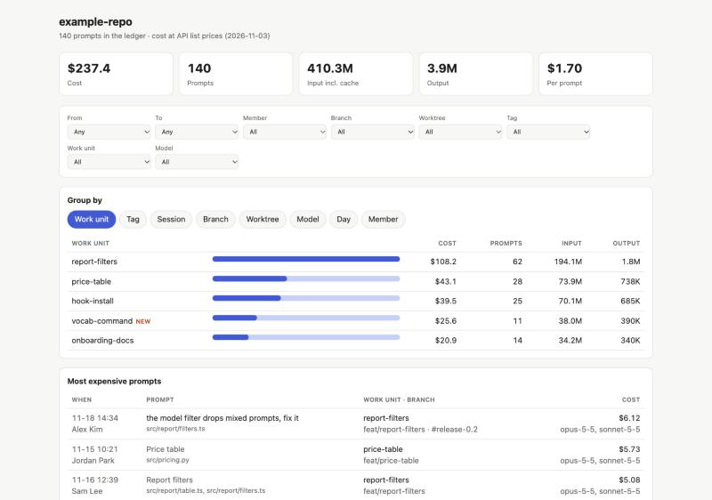

# token-ledger

English | [한국어](README.ko.md)

Ledger of Claude Code token usage per prompt, feature, branch and worktree, grouped by model, feature and session.

## Example



A report built from fictional data (three made-up members, 140 prompts). Open [`examples/report.html`](examples/report.html) in a browser to try the filters and group-by buttons, and see [`examples/token-ledger-out/`](examples/token-ledger-out/) for what gets committed: rows without prompt text, work units and the vocabulary. Regenerate with `python3 examples/make_example.py`.

## Install

```
/plugin marketplace add kwakyongwoo/token-ledger
/plugin install token-ledger@token-ledger
```

## Usage

TODO: describe the skills, commands or hooks this plugin adds, how to run them, what output to expect, and any setup they need before first use.

## Status

Early skeleton (v0.1.0). Expect breaking changes until the first stable release.
